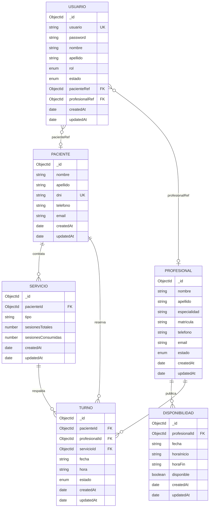

# Modelo de datos actual

La persistencia se implementa en MongoDB mediante Mongoose. Las relaciones se
representan con `ObjectId` y referencias entre modelos. Todos los esquemas
vigentes utilizan `timestamps: true`, por lo que Mongoose agrega
`createdAt` y `updatedAt`.

## Diagrama entidad-relación

## Entidades y reglas de esquema

### Usuario

Modelo: [`models/Usuario.js`](../models/Usuario.js)

| Campo | Tipo | Reglas |
|---|---|---|
| `usuario` | String | Obligatorio, único, trim |
| `password` | String | Obligatorio; bcrypt para usuarios nuevos |
| `nombre` | String | Obligatorio, trim |
| `apellido` | String | Obligatorio, trim |
| `rol` | Enum | `paciente`, `recepcionista`, `profesional`, `administrativo`, `coordinador`, `director` |
| `estado` | Enum | `activo` o `inactivo`; default `activo` |
| `pacienteRef` | ObjectId | Referencia opcional a `Paciente` |
| `profesionalRef` | ObjectId | Referencia opcional a `Profesional` |

Un paciente normalmente posee `pacienteRef`; un profesional interno puede
poseer `profesionalRef`. El modelo no impone exclusividad ni obligatoriedad
condicionada por rol.

### Paciente

Modelo: [`models/Paciente.js`](../models/Paciente.js)

| Campo | Tipo | Reglas |
|---|---|---|
| `nombre` | String | Obligatorio, trim |
| `apellido` | String | Obligatorio, trim |
| `dni` | String | Obligatorio, único, trim |
| `telefono` | String | Opcional, trim |
| `email` | String | Opcional, trim, lowercase |

### Profesional

Modelo: [`models/Profesional.js`](../models/Profesional.js)

| Campo | Tipo | Reglas |
|---|---|---|
| `nombre` | String | Obligatorio, trim |
| `apellido` | String | Obligatorio, trim |
| `especialidad` | String | Obligatorio, trim |
| `matricula` | String | Opcional, default vacío |
| `telefono` | String | Opcional, default vacío |
| `email` | String | Opcional, default vacío |
| `estado` | Enum | `activo` o `inactivo`; default `activo` |

### Disponibilidad

Modelo: [`models/Disponibilidad.js`](../models/Disponibilidad.js)

| Campo | Tipo | Reglas |
|---|---|---|
| `profesionalId` | ObjectId | Obligatorio, referencia a `Profesional` |
| `fecha` | String | Obligatorio |
| `horaInicio` | String | Obligatorio |
| `horaFin` | String | Obligatorio |
| `disponible` | Boolean | Default `true` |

El controlador rechaza solapamientos al crear un bloque para el mismo
profesional y fecha. El esquema no valida formato de fecha/hora, que
`horaInicio` sea anterior a `horaFin`, ni solapamientos al modificar un bloque.

### Servicio

Modelo: [`models/Servicio.js`](../models/Servicio.js)

| Campo | Tipo | Reglas |
|---|---|---|
| `pacienteId` | ObjectId | Obligatorio, referencia a `Paciente` |
| `tipo` | String | Obligatorio, trim |
| `sesionesTotales` | Number | Obligatorio, mínimo 1 |
| `sesionesConsumidas` | Number | Default 0, mínimo 0 |

El controlador verifica saldo al crear un turno y aumenta/disminuye el
contador durante reserva/cancelación. No hay transacción ni restricción
atómica que impida carreras concurrentes.

### Turno

Modelo: [`models/Turno.js`](../models/Turno.js)

| Campo | Tipo | Reglas |
|---|---|---|
| `pacienteId` | ObjectId | Obligatorio, referencia a `Paciente` |
| `profesionalId` | ObjectId | Obligatorio, referencia a `Profesional` |
| `servicioId` | ObjectId | Obligatorio, referencia a `Servicio` |
| `fecha` | String | Obligatorio |
| `hora` | String | Obligatorio |
| `estado` | Enum | `reservado`, `confirmado`, `cancelado`, `atendido`; default `reservado` |

La aplicación evita duplicidad exacta de profesional, fecha y hora mediante
una consulta previa, pero no existe índice único ni transacción que garantice
la exclusión bajo concurrencia.

## Reglas y relaciones de negocio

1. Un paciente puede tener múltiples servicios.
2. Un servicio pertenece a un paciente y puede respaldar múltiples turnos.
3. Un profesional puede publicar múltiples disponibilidades.
4. Un profesional puede atender múltiples turnos.
5. Una reserva requiere que el servicio pertenezca al paciente.
6. Una reserva requiere saldo disponible.
7. La disponibilidad debe cubrir la hora solicitada.
8. Un turno no cancelado ocupa la combinación profesional-fecha-hora.
9. Cancelar un turno reservado devuelve una sesión al servicio.
10. El sistema no implementa actualmente una transición específica a
    `confirmado`.

## Integridad pendiente

- Validar existencia de referencias antes de operar.
- Validar formatos ISO de fecha y `HH:mm`.
- Impedir rangos horarios invertidos.
- Agregar índices de consulta y exclusión.
- Usar transacciones para reserva y cancelación.
- Controlar autorización de pertenencia entre usuario y recurso.
- Evitar que actualizaciones genéricas modifiquen campos protegidos.
